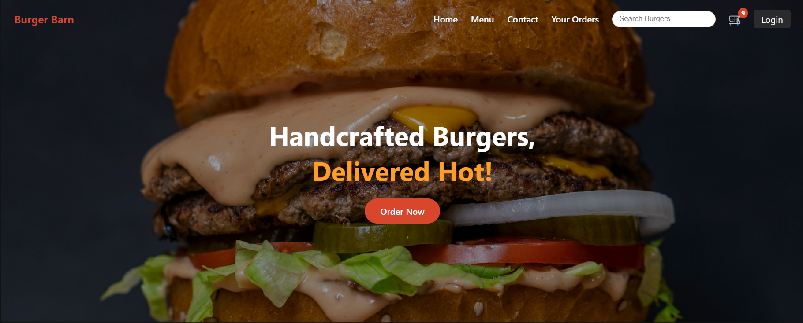
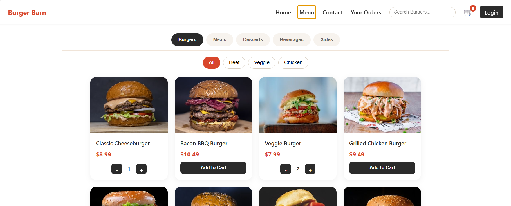
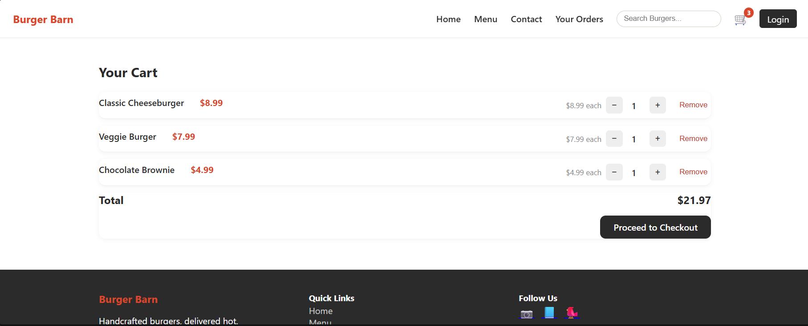
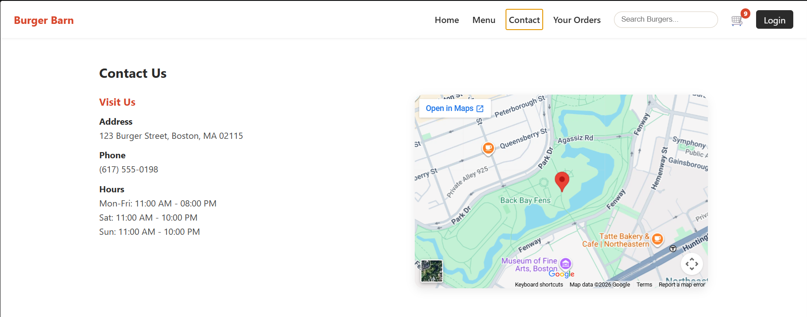
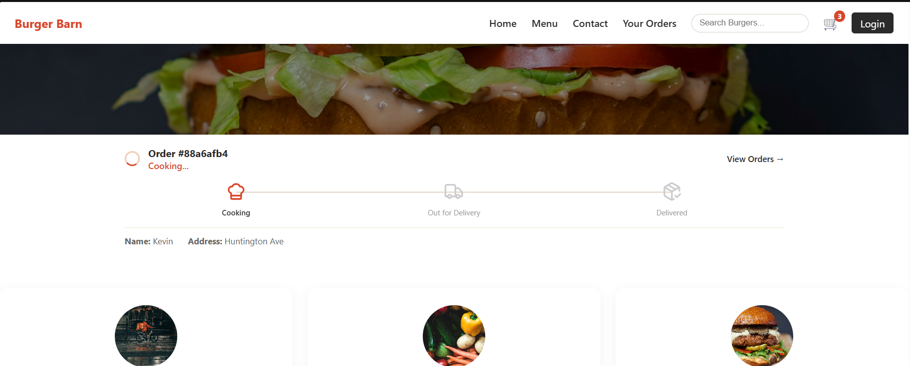
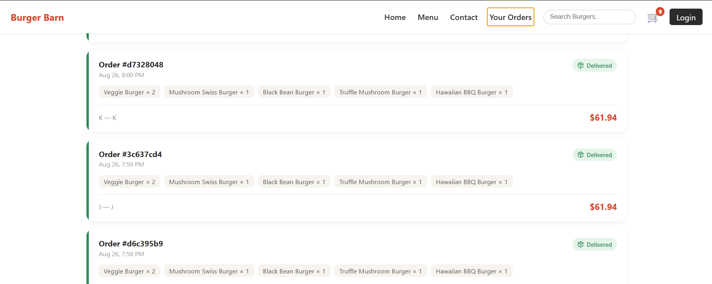

# 🍔 Burger Barn

A full-stack burger ordering and food delivery application built with **React** and **FastAPI**. Browse the menu, customize your cart, apply discounts, place orders, and track delivery progress through an interactive interface.

#### Features

##### 🏠 Browsing & Discovery
- Interactive homepage featuring weekly specials, coupon offers, customer testimonials, and service highlights.
- Browse menu categories: Burgers, Meals, Desserts, Beverages, and Sides.
- Filter burgers by type: Beef, Chicken, and Veggie.
- Contact page with business details, opening hours, and an embedded map.

##### 🛒 Cart & Checkout
- Add items to the cart directly from menu cards.
- Increase or decrease item quantities and remove items.
- Automatic price calculations and live cart totals.
- Persistent cart using `localStorage`, even after refreshing the page.
- Coupon system supporting percentage and flat discounts, minimum order values, and maximum discount limits.
- Submit orders to the FastAPI backend during checkout.

##### 🚚 Order Tracking
- Animated order status banner on the homepage.
- Three delivery stages: **Cooking → Out for Delivery → Delivered**.
- Automatic status progression based on the time elapsed since an order was placed.
- Order history page displaying placed orders and color-coded delivery statuses.

##### 🔐 User Accounts
- Sign-up and login functionality.
- Password hashing using bcrypt.
- Persistent login state across page refreshes.
- Personalized navigation displaying the logged-in user's name and logout option.

##### 🖥️ UI Preview

Add screenshots of your application below to showcase its design and user experience.

| Home Page | Menu Page |
|:---:|:---:|
|  |  |

| Cart Page | Checkout Page |
|:---:|:---:|
|  |  |

| Order Tracking | Your Orders |
|:---:|:---:|
|  |  |


##### Tech Stack

| Layer | Technologies |
|---|---|
| Frontend | React, Vite, React Router |
| UI & Icons | Plain CSS, lucide-react |
| Backend | Python, FastAPI, Uvicorn |
| Data Validation | Pydantic |
| Authentication | Passlib, bcrypt |
| Image Processing | Pillow |

##### 📁 Project Structure

```text
Burger-Barn/
├── burger-app/                 # React frontend
│   └── src/
│       ├── components/         # Reusable UI components
│       ├── pages/              # Application pages
│       ├── data/               # Coupons and testimonials
│       └── utils/              # Order status logic
│
├── burger-backend/             # FastAPI backend
│   ├── main.py
│   ├── requirements.txt
│   └── images/                 # Menu images
│
└── docs/
    └── images/                 # README screenshots
```

#### Getting Started

##### 1. Clone the Repository

```bash
git clone <YOUR_REPOSITORY_URL>
cd Burger-Barn
```

##### 2. Set Up the Backend

Navigate to the backend directory:

```bash
cd burger-backend
python -m venv venv
```

Activate the virtual environment.

**Windows:**
```bash
venv\Scripts\activate
```

**macOS / Linux:**
```bash
source venv/bin/activate
```

Install dependencies and start the server:

```bash
pip install -r requirements.txt
uvicorn main:app --reload --port 8000
```

The backend will run at `http://localhost:8000`.

Explore the interactive API documentation at `http://localhost:8000/docs`.

##### 3. Set Up the Frontend

Open a second terminal and navigate to the frontend directory:

```bash
cd burger-app
npm install
npm run dev
```

The frontend will run at `http://localhost:5173`.

Make sure both the frontend and backend servers are running while using the application.

##### API Endpoints

| Method | Endpoint | Description |
|---|---|---|
| `GET` | `/burgers` | Retrieve menu items across all categories |
| `POST` | `/orders` | Submit an order and receive its generated ID and timestamp |
| `POST` | `/signup` | Register a new user account |
| `POST` | `/login` | Authenticate a user and receive a token |
| `GET` | `/images/{file}` | Retrieve menu images |

##### Key Highlights

- Full-stack development with a React frontend and Python backend.
- Reusable React components and client-side routing.
- Cart state persistence and dynamic price calculations.
- Flexible coupon and discount logic.
- Backend API integration for order placement and account management.
- Time-based delivery status simulation.
